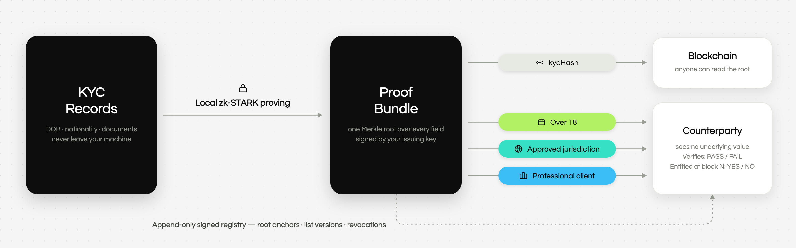

<div align="center">

<picture>
  <source media="(prefers-color-scheme: dark)" srcset="assets/kyc-zk-stark-flow-hero-dark.png">
  <source media="(prefers-color-scheme: light)" srcset="assets/kyc-zk-stark-flow-hero.png">
  
</picture>

# Trusset KYC zk-Proof Tool

**Turn a batch of KYC records into per-subject zk-STARK bundles bound to an on-chain attestation, and still explain them to a regulator five years later.**

[](https://nodejs.org/)
[](https://www.rust-lang.org/)
[](LICENSE)
[](https://github.com/facebook/winterfell)
[](https://www.typescriptlang.org/)

[Quick start](#quick-start) · [Commands](#commands) · [Configuration](#configuration) · [How it works](#how-it-works) · [Security](#security) · [Docs](#documentation)

</div>

---

## What this is

You give it KYC records. It gives you, per subject:

- a **`kycHash`**: one 32-byte root, the `root` of your IdentityHub attestation,
- a **bundle** of zk-STARK proofs behind that root, one leaf per claim, each
  naming the hub predicate it proves (`ADULT`, `EEA_RESIDENT`, `INVESTOR_CLASS`, ...),
- a **signed header** that binds the root to the wallet, the batch date, and your
  attestation (attester, chain, hub, key id),
- one **disclosure file per leaf**, so the holder can show a single claim without
  the rest of the bundle,
- an **`attestation.json`** for the issuer app to turn into the hub's `attest` call.

Everything runs on your machine. The tool sends nothing and signs no
transaction; `verify --rpc-url` is the one command that reads a chain, and only
when you ask it to.

**Read this before sharing proofs.** The proofs are sound but not
zero-knowledge (Winterfell 0.13 has no hiding mode). A predicate proof discloses
the value behind it: an `EEA_RESIDENT` proof carries the country, an `ADULT`
proof yields the date of birth. Names and document numbers are
`commitment_only` and stay hidden. Give a proof only to a party entitled to its
value; see [What a proof reveals](docs/SECURITY.md#what-a-proof-reveals).

Two questions it answers, kept apart on purpose:

| Question | Answer |
|---|---|
| Does this bundle hold together, and did you sign it? | `Verifies: PASS/FAIL`, pure cryptography |
| Could this subject rely on it *at block N*? | `Entitled: YES/NO`, adds the root live then, each claim's validity window, and revocations |

---

## Quick start

**You need:** Node.js 18+ and Rust 1.82+ (`rust-toolchain.toml` pins the exact
toolchain).

```bash
git clone https://github.com/Trusset/trusset-kyc-zk-proofs
cd trusset-kyc-zk-proofs
npm install                      # builds the Rust workspace and the CLI
```

Set up once, with your hub attestation details:

```bash
npm run init -- --issuer-name "Example Bank AG" --issuer-scheme LEI \
                --issuer-identifier 529900T8BM49AURSDO55 --issuer-jurisdiction DE \
                --chain-id 11155111 --hub 0x<IdentityHub> --attester 0x<your attesting wallet>
```

`init` generates the operator keys into an encrypted key file (it asks for a
passphrase), writes a 3.1.0 `config.json`, records version 1 of the country
allowlist and the EEA list, and prints your public key.

Publish the operator key on the hub (send the printed calldata from the
attester wallet; the tool never sends it):

```bash
npm run key -- show
```

Then issue:

```bash
cp your-records.json input/
npm run issue -- --dry-run       # checks everything, writes nothing
npm run issue                    # bundles + attestation.json per subject
```

Verify what you made:

```bash
npm run verify -- 0xYourSubject --public-key <your key>
npm run verify -- 0xYourSubject --rpc-url https://<rpc>   # once attested on chain
```

Leave `epochDaysSource` pinned (`init` pins it to the day it ran). Every key,
nonce and commitment derives from it, so a bundle proved against a moving clock
cannot be reproduced.

---

## Commands

Every command takes `--json`. Every failure names the field, the subject, and
the fix.

### Issuing

| Command | What it does |
|---|---|
| `npm run issue` | Prove `input/` into 3.1.0 bundles and an `attestation.json` per subject |
| `npm run issue -- --dry-run` | Validate the whole batch, write nothing, no keys needed |
| `npm start` | The same for a config that still emits 3.0.0 |
| `--skip-proofs` | Development: predicates checked, no STARKs (`mode: "stub"`) |
| `--no-deterministic` | Per-subject keys from OS entropy instead of the master key |
| `--dev-unpinned-epoch` | Allow a wall-clock batch date (development only) |

### Keys

```bash
npm run key -- create                    # new key, encrypted file (or --keychain)
npm run key -- encrypt --from .trusset/keys.env   # move existing keys into a store
npm run key -- show [--verify]           # public key, hub keyId, setAttesterProfile calldata
```

Keys live in an encrypted file (scrypt + ChaCha20-Poly1305) or the macOS
keychain, chosen by `security.keyStore`. `TRUSSET_KYC_SIGNING_KEY` and
`TRUSSET_KYC_MASTER_KEY` are for CI only. For an unattended run, put the
passphrase in `TRUSSET_KYC_KEY_PASSPHRASE` for that one command.

### Verifying

```bash
npm run verify -- <wallet> --root 0x<64-hex>              # anchored on the on-chain root
npm run verify -- <wallet> --public-key <64-hex>          # anchored on your key
npm run verify -- <wallet> --rpc-url <url>                # both, read from the hub, and compared
npm run verify -- <wallet> --public-key <hex> --as-of-block 8000100 --chain-id 1
npm run verify -- <wallet> --public-key <hex> --archive batch.tka

# one disclosed leaf, on its own
target/release/trusset-verifier-cli --disclosure output/<wallet>/disclosures/dateOfBirth.json \
    --public-key <hex> [--wallet 0x<subject>]
```

`--rpc-url` sends only `eth_chainId` and `eth_call`: it reads
`operatorKeyAt(attester, keyId)` and `getAttestation(attester, wallet)`, uses
them as anchors, and reports any difference between the hub record and what
the bundle proves (root, class, predicate bits, expiries, status). The RPC
provider learns which wallet you checked.

| Exit code | Meaning |
|---|---|
| `0` | Verifies (and entitled at the instant asked about) |
| `2` | Verification failed, or the hub disagrees with the bundle |
| `3` | Verifies, but not entitled then |
| `64` | Usage error |
| `66` | Bundle or archive unreadable |

### Keeping the record straight

```bash
npm run list-version -- --list-id eea --source config/list_commitments/eea.source.txt
npm run anchor -- --bundle output/0xAbCd... --chain-id 1 --block 8000100 --block-time 1787529600
npm run revoke -- --bundle output/0xAbCd... --effect lapsed --effective-date 2026-10-01 --reason PERIODIC_REVIEW_OVERDUE
npm run archive -- --output 2026Q4.tka --all output
```

These write signed, append-only records under `config/registry/`. The hub's
`revoke`, `suspend` and `erase` are the authority for on-chain readers;
`revocations.json` is your own record of lapses and voidances. Record a
revocation in both.

---

## Input format

`.json` or `.csv` files in `input/`, same fields either way:

```json
[
  {
    "walletAddress": "0xabcdef0123456789abcdef0123456789abcdef01",
    "country": "DEU",
    "investorType": "PROFESSIONAL",
    "firstName": "Alice",
    "lastName": "Anderson",
    "dateOfBirth": "1985-04-12",
    "nationality": "DEU",
    "documentType": "PASSPORT",
    "documentNumber": "P12345678",
    "documentIssuingCountry": "DEU",
    "softExpiryDays": 365,
    "hardExpiryDays": 730,
    "evidenceDate": "2026-08-01"
  }
]
```

A blank column takes the configured default; an unreadable value fails the
row. In 3.1.0 `investorType` must be `RETAIL`, `PROFESSIONAL` or
`ELIGIBLE_COUNTERPARTY` (the hub records a class), and `softExpiryDays` must
be below `hardExpiryDays`.

---

## Output

```
output/
├── 0xAbCd.../
│   ├── kycHash.hex          # the root you attest
│   ├── manifest.json        # what was asserted, by whom, on what evidence
│   ├── manifest.sig         # ed25519 over the canonical manifest
│   ├── header.json          # 3.1: root, wallet, date, attester, chain, hub, keyId
│   ├── header.sig           # 3.1: ed25519 over the 155-byte header
│   ├── disclosures/*.json   # 3.1: one leaf, its inclusion path, the signed header
│   ├── attestation.json     # 3.1: input for the hub attest call
│   ├── proofs/*.bin         # one STARK per proving leaf; 0 bytes for commitment-only
│   └── secrets.enc          # encrypted witnesses, operator-private, never ship it
├── kyc_hashes_<ts>.csv      # one row per subject (3.1: no country column)
├── failures.csv             # only when something failed
└── audit.log                # per-run event log, no personal data
```

---

## Configuration

`npm run init` writes a complete `config.json`; `config.example.v3.1.json` is
the same shape with placeholders. The 3.1.0 parts:

```json
"manifest": { "version": "3.1.0", "issuer": { "...": "..." } },
"chain": { "chainId": 11155111, "hub": "0x...", "attester": "0x...", "keyId": 1 },
"security": { "keyStore": { "type": "file", "path": ".trusset/operator.key" }, "...": "..." },
"predicates": {
  "dateOfBirth": { "circuit": "age_threshold", "params": { "minAgeYears": 18 }, "predicate": "ADULT", "descriptor": {}, "validity": { "days": 3650 } },
  "country": [
    { "circuit": "set_membership", "params": { "list": "eea" }, "predicate": "EEA_RESIDENT", "optional": true, "descriptor": {}, "validity": { "days": 365 } },
    { "circuit": "set_membership", "params": { "list": "country_allowlist" }, "predicate": "RESIDENCY_ON_FILE", "descriptor": {}, "validity": { "days": 365 } }
  ],
  "investorType": { "circuit": "tier_threshold", "params": { "minTier": "ATTESTED" }, "predicate": "INVESTOR_CLASS", "descriptor": {}, "validity": { "days": 730 } },
  "firstName": { "circuit": "commitment_only", "params": { "maxValueBytes": 128 }, "descriptor": {}, "validity": { "days": 365 } }
}
```

- **`chain.keyId`** is the hub's id for your operator key: 1 for your first,
  incremented by the hub each time you publish a new key.
- **`predicate`** names the hub bit the leaf proves. Allowed: `ADULT`,
  `EEA_RESIDENT`, `RESIDENCY_ON_FILE`, `CITIZENSHIP_ON_FILE`,
  `TAX_RESIDENCY_ON_FILE`, `ACCREDITED`, `INVESTOR_CLASS` (exactly one).
- **`optional: true`** leaves the leaf out when the subject does not meet it, so
  a non-EEA resident still gets a bundle, without the `EEA_RESIDENT` bit.
- **`minTier: "ATTESTED"`** proves the subject's own class, which becomes the
  attestation's `investorClass`.
- **`descriptor`** (legal basis, evidence class, warranting party) and
  **`validity`** are hashed into each leaf, as in 3.0. See
  [CIRCUITS.md](docs/CIRCUITS.md).

Circuits:

| Circuit | Proves | Use for |
|---|---|---|
| `age_threshold` | at least N days old on the batch date | `dateOfBirth` (`ADULT`) |
| `set_membership` | value is in a recorded list | `country` (`EEA_RESIDENT`, `RESIDENCY_ON_FILE`), `nationality` |
| `tier_threshold` | tier at or above a floor | `investorType` (`INVESTOR_CLASS`) |
| `commitment_only` | a hiding commitment, no STARK | names, document numbers |
| `preimage_knowledge` | knowledge of a commitment opening | rarely what you want |

---

## How it works

Each claim becomes a leaf. The value is committed with Rescue-Prime and a
32-byte per-leaf nonce, a STARK proves the predicate about the commitment, and
the leaf hash binds field name, circuit, wallet, batch date, commitment, public
inputs, proof, and the binding block (descriptor, validity, list version,
predicate). Leaves are sorted, padded to a power of two, and merged into the
Merkle v3 root; every leaf gets its inclusion path. The operator key signs the
manifest and a 155-byte header (`abi.encodePacked` layout) naming root,
wallet, date, attester, chain, hub, key id, Merkle version, and leaf count.

```
operator key file (passphrase)  →  signing key  →  manifest.sig, header.sig, registries
                                →  master key   →  wraps each subject key in secrets.enc
                                                    →  per-leaf nonces
```

[ARCHITECTURE.md](docs/ARCHITECTURE.md) has the crate map,
[CIRCUITS.md](docs/CIRCUITS.md) the exact formats.

---

## What changed in 3.1

| Before | Now |
|---|---|
| `country` and `investorType` in clear text in the bundle and the CSV | Predicate leaves; clear text nowhere in a 3.1.0 bundle |
| A holder had to hand over the whole manifest | One leaf, its path, and the signed header verify on their own (`verify_disclosure`) |
| A bundle was tied to nothing on chain | The signed header names attester, chain, hub and key id; `verify --rpc-url` compares |
| Leaves did not say which hub predicate they prove | `binding.predicate`, inside the leaf hash |
| Operator key in a shell environment variable | Encrypted key file or macOS keychain; env vars for CI only |
| Proof hiding assumed | Checked: not available in Winterfell 0.13; what a proof reveals is documented |

2.0.0, 2.1.0 and 3.0.0 bundles keep verifying, strict mode included. Upgrade
path: [MIGRATION_V30_TO_V31.md](docs/MIGRATION_V30_TO_V31.md).

---

## Security

| | |
|---|---|
| **Bound to one attestation** | The signed header names root, wallet, date, attester, chain, hub and key id |
| **Hiding commitments** | 32-byte per-leaf nonces; names and document numbers are commitment-only |
| **Not zero-knowledge** | A predicate proof discloses its value. Share proofs only with parties entitled to the value |
| **Replay protection** | Wallet, batch date, circuit, descriptor, and predicate inside every leaf hash |
| **Strict formats** | Exact JSON shapes, one spelling per digest, canonical proof bytes, strict ed25519 for headers |
| **Keys at rest** | scrypt + ChaCha20-Poly1305 key file, or the keychain; keys reach the Rust binaries over stdin |
| **Determinism** | Pinned date + same master key gives byte-identical reruns |
| **Reproducible builds** | `scripts/reproducible-build.sh` remaps paths so `proverSha256` can be rebuilt bit for bit |

Full threat model: [SECURITY.md](docs/SECURITY.md).

---

## Troubleshooting

| Symptom | Fix |
|---|---|
| `chain: missing` | A 3.1.0 config needs `chain` (chainId, hub, attester, keyId) |
| `exactly one INVESTOR_CLASS predicate` | `investorType` with `"minTier": "ATTESTED", "predicate": "INVESTOR_CLASS"` |
| `E_TIER_NONE` on a row | The hub needs a class: set `investorType` to RETAIL, PROFESSIONAL or ELIGIBLE_COUNTERPARTY |
| `E_LIST_MEMBER_MISSING` | The value is not in the list. Mark the predicate `optional` (for example `EEA_RESIDENT`), or fix the list |
| `The key file did not decrypt` | Wrong passphrase, or the file was edited. Restore it from backup |
| `No terminal to ask for the key passphrase` | Run interactively, or set `TRUSSET_KYC_KEY_PASSPHRASE` for that one command |
| `epochDaysSource is "utc_today"` | Pin it: `"fixed:<day>"`. `init` does this |
| `Entitled: NO` but `Verifies: PASS` | The claim lapsed, was voided, or is outside its window |

---

## Documentation

| | |
|---|---|
| [CIRCUITS.md](docs/CIRCUITS.md) | What each circuit proves; leaf, Merkle v3, header, disclosure and attestation formats |
| [SECURITY.md](docs/SECURITY.md) | Threat model, what a proof reveals, keys, revocation |
| [MIGRATION_V30_TO_V31.md](docs/MIGRATION_V30_TO_V31.md) | Upgrading from 3.0, and what the backend pins |
| [MIGRATION_V2_TO_V3.md](docs/MIGRATION_V2_TO_V3.md) | The 2.x to 3.0 path |
| [ARCHITECTURE.md](docs/ARCHITECTURE.md) | Crate map and data flow |
| [PERFORMANCE.md](docs/PERFORMANCE.md) | Measured times and sizes |
| [FUTURE_WORK.md](docs/FUTURE_WORK.md) | What was left out, including hiding proofs |
| `test-vectors/` | Shared vectors: a 3.1.0 bundle, disclosures, negative cases, and 2.1.0/3.0.0 bundles |

### Contributing

```bash
cargo build --workspace && cargo test --workspace
cargo clippy --workspace --all-targets -- -D warnings
(cd cli && npm test)
npm run test:wasm                         # builds the WASM verifier and runs tests/wasm/
TRUSSET_VECTORS_REFRESH=1 cargo test -p trusset-verifier --release --test v31_vectors   # after a format change
```

---

<div align="center">

Built by [Trusset](https://trusset.org) · [Report an issue](https://trusset.org/contact)

</div>
