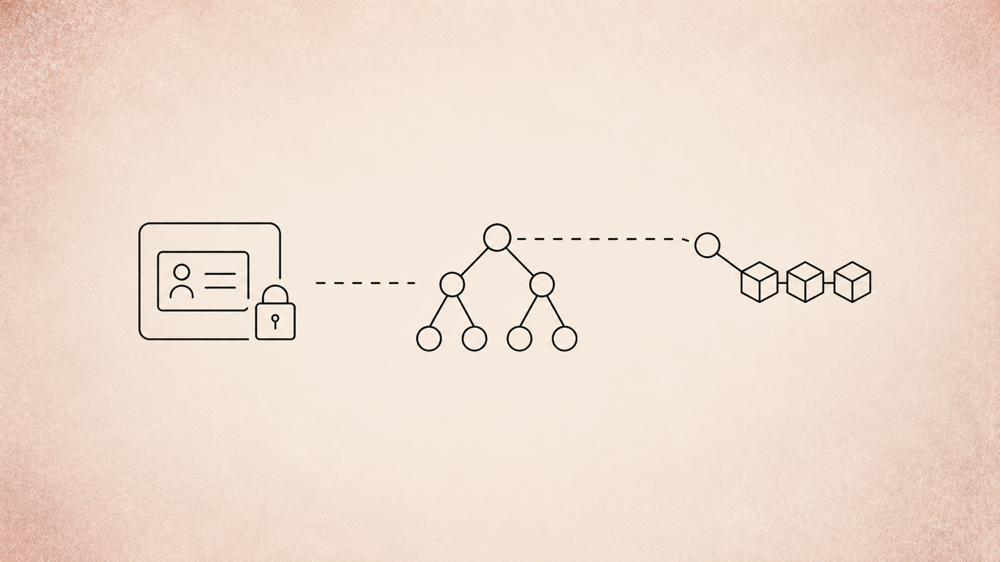

<div align="center">



# Trusset KYC zk-Proof Tool

**Generate per-leaf zk-STARK KYC proofs for on-chain identity attestation.**

[](https://nodejs.org/)
[](https://www.rust-lang.org/)
[](LICENSE)
[](https://github.com/facebook/winterfell)
[](https://www.typescriptlang.org/)

[Quick Start](#quick-start) · [Usage](#usage) · [Configuration](#configuration) · [Security](#security)

</div>

---

## How it works

Each KYC field is bound to a per-leaf zk-STARK that proves a predicate or knowledge claim about its private value. Leaves are committed via a hiding Rescue-Prime commitment with a fresh per-leaf nonce, then sorted lexicographically and merged pairwise into a Rescue-Prime Merkle root. That root is the `kycHash` published to the Trusset network.

What changes from v1: each leaf carries a STARK proof instead of an unprotected `keccak256(fieldName, value)`. Banks can selectively disclose predicates ("over 18", "country in allowlist", "investor tier at least Professional") without revealing the underlying values, and low-entropy fields like `dateOfBirth` are no longer rainbow-table vulnerable to anyone holding a Merkle inclusion proof.

The tool runs entirely on the operator's machine: all proving is local, the master key never leaves the host, and `secrets.enc` is the only place plaintext-equivalent witness material lives on disk.

## Quick Start

Requirements: Node.js 18+, Rust 1.75+ with the `wasm32-unknown-unknown` target installed.

```bash
git clone https://github.com/Trusset/trusset-kyc-hashing.git
cd trusset-kyc-hashing
npm install                              # builds Rust workspace + WASM verifier + TS CLI
cp config.example.json config.json
export TRUSSET_KYC_MASTER_KEY=$(openssl rand -hex 32)
export TRUSSET_KYC_SIGNING_KEY=$(openssl rand -hex 32)
```

The first install compiles ~50 Rust crates; subsequent builds are incremental.

## Usage

**Hash KYC data:**

```bash
npm start                       # Read /input, prove every subject, write bundles + index CSV
npm start -- --raw              # Omit the index column from the batched CSV
npm start -- --skip-proofs      # Emit zero-byte proof files (CI smoke mode)
```

**Verify a bundle as a counterparty:**

```bash
npm run verify -- 0xAbCdEf... --public-key <64-hex-of-operator-ed25519-pubkey>
```

**Inspect resolved configuration:**

```bash
npm run show
```

Every command supports `--json` for machine-readable output.

## Input / Output

| Direction | Details |
|-----------|---------|
| **Input** | Place `.json` or `.csv` files in `/input` |
| **Output (per subject)** | `/output/<wallet>/{manifest.json, manifest.sig, kycHash.hex, proofs/<field>.bin, secrets.enc}` |
| **Output (batch index)** | `/output/kyc_hashes_<timestamp>.csv` — v1-compatible row-per-subject summary for legacy uploaders |
| **Output (failures)** | `/output/failures.csv` — only created when at least one subject failed |
| **Cleanup** | `/input` cleared after processing (configurable) |

Two failure stages are recorded: rows that fail TS-side validation (bad wallet, missing country) are quarantined before the prover spawns; rows that fail in the prover (under-age, country not in allowlist, tier=NONE) are isolated per-subject and the rest of the batch continues.

## Configuration

`config.json` extends v1 additively. The example shipped at `config.example.json`:

```json
{
  "mapping": {
    "fields": ["firstName", "lastName", "dateOfBirth", "nationality",
               "documentType", "documentNumber", "documentIssuingCountry"],
    "walletAddressField": "walletAddress",
    "countryField": "country",
    "investorTypeField": "investorType",
    "softExpiryDaysField": "softExpiryDays",
    "hardExpiryDaysField": "hardExpiryDays"
  },
  "predicates": {
    "dateOfBirth":  { "circuit": "age_threshold",      "params": { "minAgeYears": 18 } },
    "country":      { "circuit": "set_membership",     "params": { "list": "country_allowlist" } },
    "nationality":  { "circuit": "set_membership",     "params": { "list": "country_allowlist" } },
    "investorType": { "circuit": "tier_threshold",     "params": { "minTier": "RETAIL" } },
    "firstName":    { "circuit": "preimage_knowledge", "params": { "maxValueBytes": 128 } }
  },
  "tiers": { "NONE": 0, "RETAIL": 1, "PROFESSIONAL": 2, "ELIGIBLE_COUNTERPARTY": 3 },
  "lists": {
    "country_allowlist": {
      "path": "config/list_commitments/country_allowlist.json"
    }
  },
  "security": {
    "clearInputAfterProcessing": true,
    "masterKeyEnv": "TRUSSET_KYC_MASTER_KEY",
    "epochDaysSource": "utc_today",
    "deterministic": true
  },
  "manifest": { "signingKeyEnv": "TRUSSET_KYC_SIGNING_KEY" }
}
```

`predicates` maps each hashed field to its circuit and params. Spec defaults apply if a field is omitted. `set_membership` lists must reference a commitment file built by `trusset-list-commit` (see `docs/CIRCUITS.md`). `epochDaysSource` may be `utc_today`, `fixed:<n>`, or `env:<VAR>` — pin it for byte-stable reruns.

## Input Format Example

**JSON:**

```json
[
  {
    "walletAddress": "0xabcdef0123456789abcdef0123456789abcdef01",
    "country": "DEU",
    "investorType": "PROFESSIONAL",
    "firstName": "Alice",
    "lastName": "Anderson",
    "dateOfBirth": "1985-04-12",
    "nationality": "DEU",
    "documentType": "PASSPORT",
    "documentNumber": "P12345678",
    "documentIssuingCountry": "DEU"
  }
]
```

**CSV:**

```csv
walletAddress,country,investorType,firstName,lastName,dateOfBirth,nationality,documentType,documentNumber,documentIssuingCountry
0xabcdef0123456789abcdef0123456789abcdef01,DEU,PROFESSIONAL,Alice,Anderson,1985-04-12,DEU,PASSPORT,P12345678,DEU
```

## Output Format Example

```
output/
├── 0xAbCd.../
│   ├── kycHash.hex              # 0x-prefixed Rescue Merkle root
│   ├── manifest.json            # signed bundle manifest
│   ├── manifest.sig             # ed25519 signature (sibling)
│   ├── proofs/
│   │   ├── dateOfBirth.bin      # zk-STARK proof binding to commitment
│   │   ├── firstName.bin
│   │   └── ...
│   └── secrets.enc              # xsalsa20-poly1305 encrypted witness blob
└── kyc_hashes_<timestamp>.csv   # batched index for the Trusset uploader
```

The batched CSV preserves the v1 row schema:

```csv
index,walletAddress,country,investorType,softExpiryDays,hardExpiryDays,kycHash
1,0xAbCd...,DEU,PROFESSIONAL,365,730,0x9f1c...
```

Each row maps directly to the `/customers/api/identity/verify` request body in the Trusset issuer backend.

## Security

> All operations run entirely on your local machine. The master key never leaves the host.

| Feature | Details |
|---------|---------|
| **Local only** | No outbound network calls during proving |
| **Auto cleanup** | Input cleared after processing |
| **Hiding commitments** | Per-leaf 32-byte nonces derived via HKDF from `TRUSSET_KYC_MASTER_KEY` |
| **Domain separation** | Seven 32-byte tags (`LEAF`, `NODE`, `PUB-DIGEST`, `PRF-DIGEST`, `SET-LEAF`, `SET-NODE`, `COMMIT`) enforce non-collision across primitives |
| **Manifest signing** | ed25519 over a sentinel-`createdAt` canonical view — byte-identical signatures across runs |
| **Encrypted at rest** | `secrets.enc` is xsalsa20-poly1305 (libsodium-compatible), per-subject HKDF-derived key |
| **Determinism** | Pinned `epochDaysSource` + fixed master key → byte-identical bundles across runs |
| **Cryptographic stack** | Goldilocks field, Rescue-Prime hash, Winterfell STARK, all PQ-friendly |

Detailed security model: see [docs/SECURITY.md](docs/SECURITY.md).

## Phase status

The repository is in **Phase 2B Step-B** — Winterfell integration plumbing complete across all four circuits, the Rescue-Prime AIR gadget is shipped, and the **v2 felt-level commitment scheme** is live (replacing the byte-level v1). The AIR constraint bodies for the four circuits remain PLACEHOLDERS pending a final implementation pass on top of the new primitives.

Step-B progress (this session):

- **Rescue-Prime AIR gadget** ([circuits/common/src/rescue_air.rs](circuits/common/src/rescue_air.rs)) — workspace-shared module with pinned `Rp64_256` constants (12-element state, 7 rounds × 2 sub-rounds, MDS, INV_MDS, ARK1, ARK2, α=7, α⁻¹=10540996611094048183), host-side `apply_permutation` / `permutation_trace` / `hash_elements_via_trace` / `merge_via_trace`, degree-7 AIR constraint helpers (`enforce_first_half`, `enforce_second_half`), and periodic-column builder. Byte-equality with `Rp64_256` verified by 32 KAT tests ([circuits/common/tests/rescue_air_kat.rs](circuits/common/tests/rescue_air_kat.rs) + inline).
- **v2 felt-level commitment** ([circuits/common/src/commitment.rs](circuits/common/src/commitment.rs)) — replaces the v1 byte-level scheme. Formula: `Rescue(bytes_to_field(COMMITMENT_TAG) ‖ Felt(circuit_id) ‖ Felt(witness_felts.len()) ‖ witness_felts ‖ bytes_to_field(nonce))`. The 32-byte `COMMITMENT_TAG` domain is preserved unchanged; witness is supplied as felts via per-circuit `witness_to_felts` helpers. Adds `circuit_id` as cross-circuit domain separator (v1 lacked this protection). See [docs/STEP_2B_COMMITMENT_DESIGN.md](docs/STEP_2B_COMMITMENT_DESIGN.md) for the rationale (Path B chosen over byte-decomposition which would have inflated AIR trace widths to ~250 columns, missing perf targets by ~7×).
- **`CIRCUITS_VERSION` bumped 1 → 2** ([circuits/common/src/lib.rs:47](circuits/common/src/lib.rs#L47)) — tags the wire-level value change. Every cached v1 bundle is invalidated; counterparty verifiers will reject mixed-version proofs.
- All four circuit crates now use the v2 commitment in their `commit()` / `validate()` paths via per-circuit `witness_to_felts` helpers (1 felt for `tier_threshold`/`age_threshold`, `bytes_to_field(value)` for `preimage_knowledge`/`set_membership`).

Step-B Stages 4-5 progress (this session):

- **Real commitment-opening AIR for `tier_threshold`** ([circuits/tier_threshold/src/air.rs](circuits/tier_threshold/src/air.rs)): 16-col × 32-row Winterfell trace with degree-7 Rescue first-half / second-half transition constraints (built on the Rescue gadget), absorption transition at row 14, stall padding at rows 29-30. **Plus Pattern A predicate columns** (`tier_col`, `acc_tier`, `slack_col`, `acc_slack`) that enforce `tier ∈ {1,2,3}` AND `tier ≥ min_tier` AT PROVE TIME via boundary constraints on the row-3 accumulators. 21 periodic columns (12 `ark_combined` + 4 Rescue selectors + 5 predicate selectors/factors), 18 transition constraints, 19 boundary constraints. **45/45 tests** under `--features prod-proofs-tier` including 5 new AIR-time negative-witness tests (`air_rejects_tier_zero/four/five/below_min_tier` + positive control) that bypass `validate()` and confirm the AIR is the rejection layer.
- **Real commitment-opening + 22-bit boolean range AIR for `age_threshold`** ([circuits/age_threshold/src/air.rs](circuits/age_threshold/src/air.rs)): 34-col × 32-row Winterfell trace (12 Rescue state + 22 boolean bit columns) with 12 state constraints + 22 boolean checks + 1 linear-combination check. The linear-combination constraint enforces `(current_epoch_days − state[11] − min_age_days) = Σ bit_i · 2^i`, which combined with the boolean checks proves `slack ∈ [0, 2^22)` at AIR-prove time. Time-travel (`dob_days > current_epoch_days`) and underage (`current_epoch_days − dob_days < min_age_days`) wrap the field subtraction past `2^22`, causing the linear constraint to fail. **32/32 tests** under `--features prod-proofs-age` including 5 AIR-time negatives (`air_rejects_time_travel/underage/one_day_short` + positive controls for exact-min-age and well-over-min-age).
- **Soundness impact**: **All four circuits at full audit-ready in-AIR cryptographic soundness.** A malicious prover cannot construct a valid proof for any spec-violating witness — neither commitment-mismatch (Rescue collision resistance) nor predicate violation (Pattern A for tier; boolean-range for age; 16-bit length decomposition for preimage; conditional-swap Merkle walk to set_root for set_membership). All predicates enforced inside the Winterfell AIR, not in trusted off-AIR `validate()` code.

**Phase 2B Step-B status — COMPLETE through Stage 31 (2026-05-20)**:

- **Stage 16 (set_membership Merkle walk)** — shipped via Stage 21 production promotion. 33-col × 2048-row trace with depth-dependent `set_root` boundary at row `89 + 30 × set_depth`. Operator action on upgrade: re-run `trusset-list-commit` for every list-commitment file (set_leaf_digest formula changed).
- **Stage 17 (preimage length-range)** — shipped via Stage 22 production promotion. 28-col × 64-row trace with 8-bit boolean decomposition of `value_len_bytes` + `slack = AIR_MAX_VALUE_BYTES (128) - value_len_bytes`. No bundle wire-format change.
- **Stage 18 (production mode flip)** — shipped via Stage 23. Workspace default features flipped to `prod-proofs-*`; `manifest.mode` defaults to `"production"`; verifier strict mode is the default with `--accept-stub` as opt-in. Development bundles via `npm start -- --skip-proofs` retain `mode: "stub"` and verify only under `--accept-stub`.
- **Stage 24 (performance baseline)** — refreshed prove/verify measurements: tier 565 ms, age 204 ms, preimage 362 ms, set 1768 ms (depth-2). All four circuits comfortably meet verify + proof-size spec budgets; prove-time gaps vs §13.6 targets are filed as Phase 2C optimization (not soundness-blocking).
- **Stage 25 (WASM structural drift detection)** — strengthened build check with section-table parsing, wasm-bindgen ABI import validation, and opt-in byte-determinism check.
- **Stage 27 (set_membership debug/release symmetry)** — Phase 2C item #3 closed. Prover injects alternating side-bit values in trace stall rows so Winterfell's debug-mode degree-consistency check accepts every witness path (including all-left and all-right index-0 paths). Soundness unchanged.
- **Stage 28 (release-gate doc refresh)** — `docs/RELEASE_GATE.md` brought in line with Stages 16–27: §12.10 closed, §13.6 informational, "Phase 2B Step-B is shippable as" section added.
- **Stage 29 (spec §12.11 memory profile)** — `scripts/memory_profile.sh` ships; N=50 baseline 112.7 MB peak RSS, ~2.25 MB/subject (constant ~75 MB Node+binary footprint amortized). N=1000 projects to ~600 MB, well within the 4 GB spec budget.
- **Stage 30 (WASM runtime parity)** — Phase 2C item #1 closed. `tests/e2e/wasm_parity.sh` runs the native CLI + WASM-in-Node verifier on the same fresh production bundle, asserts byte-identical `VerifyReport` JSON. Includes a single-byte tamper negative case. Operator prereq: `cargo install wasm-bindgen-cli --version 0.2.121 --locked`.
- **Stage 31 (spec §12.12 `audit.log` emission)** — last unchecked row in the spec §12 traceability matrix. `prover/src/audit.rs` writes `<output_root>/audit.log` on every run: ISO-8601 UTC timestamps, library versions (winterfell pinned 0.13.1), config_hash, list_commitments (per-list source SHA-256), skip_proofs, subject_count, then per-subject `subject_start` / `leaf_proved` / `subject_done` / `subject_failed` events. PII-free by design — `subject_failed` records the stable error_code only, no human-readable message (messages can encode attribute values like "age 17 < 18"). Schema is pinned by test; full spec §12 matrix is now ✓.

**Test totals (post Stage 31)**:

- `cargo test --workspace --release`: 418 / 418 ✓
- `cargo test --workspace` (debug, post-Stage-27): 418 / 418 ✓
- Per-circuit prod-proofs feature paths: tier 45, age 32, preimage 48, set 93 = 218 tests
- TS CLI: 11 / 11 ✓
- Determinism canary: byte-identical bundles across two runs
- Memory profile: 112.7 MB peak RSS at N=50, ~2.25 MB/subject (well within 4 GB cap)
- WASM runtime parity: native CLI ≡ WASM-in-Node `VerifyReport` JSON (positive + tamper)
- Full CI smoke sweep ([scripts/ci_smoke.sh](scripts/ci_smoke.sh)): green end-to-end

The TS CLI, prover binary, verifier binary, list-commit tool, and bundle format remain stable (JSON keys, signing scheme, secrets.enc layout, NDJSON events, CSV columns, 7 domain tags all preserved). The wire-level changes since v1:
- v1 → v2: `CIRCUITS_VERSION` bumped 1 → 2, commitment hash values change (felt-level v2 commitment with `circuit_id` domain separator)
- v2 pre-Stage-16 → v2 Stage 16+: `set_leaf_digest` formula changed (padded witness); operator must re-run `trusset-list-commit`
- v2 pre-Stage-23 → v2 Stage 23+: `manifest.mode` default `"stub"` → `"production"`, `manifest.stark.library` `"winterfell-stub"` → `"winterfell-0.13"`

**Remaining Phase 2C work** (operational, not Phase 2B-blocking, not soundness-affecting):
- ~~WASM runtime parity~~ — ✓ closed Stage 30 ([tests/e2e/wasm_parity.sh](tests/e2e/wasm_parity.sh))
- ~~Workspace-debug-mode set_membership AIR Winterfell quirk~~ — ✓ closed Stage 27
- `tier_threshold` / `preimage_knowledge` / `set_membership` prove-time optimization — open (structural, requires Winterfell-internal profiling)
- Post-audit iteration in response to external auditor feedback — open (awaiting auditor)

## Additional Documentation

- [docs/ARCHITECTURE.md](docs/ARCHITECTURE.md) — crate map, data flow, library choices
- [docs/CIRCUITS.md](docs/CIRCUITS.md) — formal predicate statements per circuit
- [docs/SECURITY.md](docs/SECURITY.md) — threat model, key management, recovery
- [docs/MIGRATION_FROM_V1.md](docs/MIGRATION_FROM_V1.md) — v1 upgrade path
- [docs/AUDIT_PREP.md](docs/AUDIT_PREP.md) — spec §12 traceability matrix
- [docs/PERFORMANCE.md](docs/PERFORMANCE.md) — measured baselines (Stage 24 production-AIR prove/verify times + historical Phase 2A/Step-A numbers)
- [docs/RELEASE_GATE.md](docs/RELEASE_GATE.md) — v2.0.0 release-gate results
- [docs/STEP_2B_DESIGN.md](docs/STEP_2B_DESIGN.md) — design write-up for the next-session real-AIR work

---

<div align="center">

Built by [Trusset](https://trusset.org) · [Report an Issue](https://trusset.org/contact)

</div>
